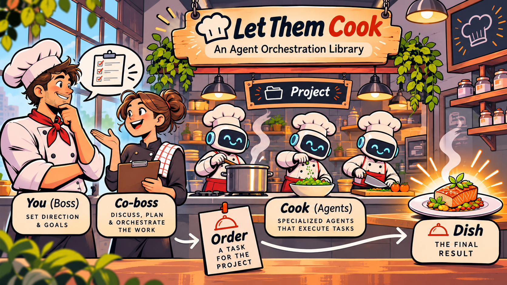

# LetThemCook



Give a coding task to your project's **Chef** in Herdr Desktop. The Chef keeps track of the **Order**, assigns a **Cook** to work in a separate working copy, and brings the **Dish** back for review. You’re the **Boss**. You decide when the result is ready to land.

## Place your first order

Open Herdr Desktop. With Git and either Codex or Claude Code installed, clone LetThemCook and start a conversation in its folder.

```sh
git clone https://github.com/kmiters/LetThemCook.git
cd LetThemCook
codex "Set up LetThemCook"
```

For Claude Code, use `claude "Set up LetThemCook"` as the last command. Follow the CLI’s sign-in prompts and review the folder it asks you to trust. If you arrive at an empty conversation, or your agent was already open in the checkout, say **“Set up LetThemCook.”**

1. Your agent connects this installation to Herdr and tells you where to find **Chef @ Let Them Cook**. Open that tab and complete any sign-in or folder trust prompt there.
2. The Chef asks “What would you like to cook up?” and “Which folder is your project in?” Give it your goal and the path to a Git project with at least one commit.
3. Open **Chef @ your-project**. After it connects, it picks up your goal and asks whether to begin. When you’re ready, tell it to go ahead.

Here are a few things you can say to your Chef.

- “Fix the settings save button. Show me how to verify the fix.”
- “What’s cooking, and is anything blocked?”
- “The preview looks good. I accept this task for local integration.”

## Find your orders and results

Ask the Chef for the project board, or run `bin/ltc-tasks your-project` from your LetThemCook checkout. Open a ticket to see the brief, saved Cook reports, and any review links. For terminal status, run `bin/ltc-status your-project` or ask the Chef for a progress update.

- [Track daily token usage](docs/token-usage.md) for local model totals and changes in average daily use.
- [Annotate a web preview](docs/workflow.md#annotate-a-web-preview-with-lavish) or [review a saved Cook report](docs/workflow.md#annotate-a-saved-cook-report) and collect Lavish feedback in the chosen backlog.
- [Set up a project](docs/setup.md) for requirements, registration, and startup help.
- [Work with your Chef](docs/workflow.md) for boards, progress, previews, and acceptance.
- [Configure profiles and workspaces](docs/configuration.md) for agent settings and projects with multiple repositories.
- [Operate and troubleshoot runs](docs/operations.md) for dispatch, reports, monitoring, recovery, and cleanup.

The Cook role is adapted from Firstmate. [Third-party license](THIRD_PARTY_LICENSES.md)
